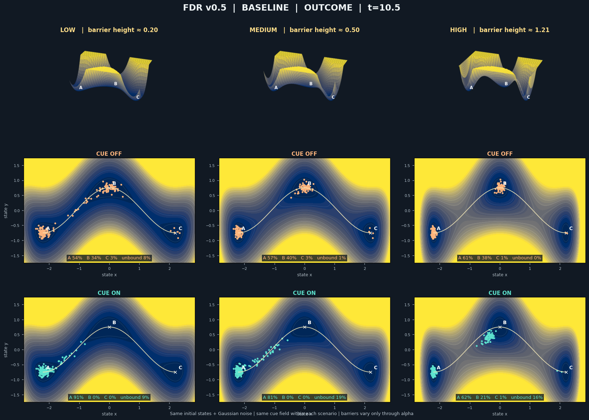

# FDR Conceptual Simulation — v0.5 Showcase

**Hashirigaki Lab · Research concept demo · 2026-11**

> **Status:** Conceptual, exploratory simulation. This is **not** an established model of memory, an experimental neuroscience finding, or a validation of the Flow–Dissipation–Reconvergence (FDR) hypothesis.

A visual demonstration of how a structured state-space landscape can shape dispersal, basin switching, and (re)convergence, alongside an explicitly imposed Cue field.

**Start here:** [Model assumptions and full parameter guide](docs/model-and-parameters.md) · [Verification record](docs/verification.md) · [Hashirigaki Lab portfolio](https://github.com/Hashirigaki)

## Preview



- [Standard six-panel movie (MP4)](outputs/showcase_v0.5/FDR_v0_5_standard_6panel.mp4)
- [Diffuse-stress six-panel movie (MP4)](outputs/showcase_v0.5/FDR_v0_5_diffuse_stress_6panel.mp4)
- [W-type 3D terrain comparison](outputs/showcase_v0.5/FDR_v0_5_terrain_3d.png)
- [Readout timecourses](outputs/showcase_v0.5/FDR_v0_5_timecourses.png)

## Model idea

The 2D toy landscape is a three-well potential, with a W-shaped trench centerline:

$$
U_\alpha(x,y) = \alpha x^2(x^2-L^2)^2 + \beta\left(y-H\cos\left(\frac{\pi x}{L}\right)\right)^2 + \gamma\left(y-H\cos\left(\frac{\pi x}{L}\right)\right)^4.
$$

At the *specified trench centerline*, the barrier height between adjacent minima is
$\Delta U_{\mathrm{trench}} = 4\alpha L^6/27$. This is **not** claimed to be the globally minimal transition saddle in the 2D potential.

The sampled trajectories use an Itô Euler–Maruyama approximation:

$$
\mathrm{d}\mathbf{X}_t = \bigl[-\kappa(t)\nabla U_\alpha(\mathbf{X}_t)
+ \mathbf{F}_{\mathrm{cue}}(t,\mathbf{X}_t)
+ \mathbf{F}_{\mathrm{escape}}(t,\mathbf{X}_t)\bigr]\mathrm{d}t
+ \sqrt{2D(t)g(U_\alpha(\mathbf{X}_t))}\,\mathrm{d}\mathbf{W}_t.
$$

Each comparison reuses the **same initial coordinates and standard normal random innovations**. Because diffusion can depend on the state, identical random innovations do not always imply identical realized noise displacements. The simulations are not assumed to represent actual neural memory units.

## Six-panel design

Three barrier heights × Cue OFF/ON create six simultaneous trajectories. The top row of the figure shows three 3D landscapes **at a shared visual scale**; the two lower rows show six top-down particle plots. Surface heights are clipped *for visualization only*; gradients and dynamics use the original potential.

| Barrier | $\alpha$ | $\Delta U_{\mathrm{trench}}$ |
|---|---:|---:|
| LOW | 0.012 | 0.20 |
| MEDIUM | 0.030 | 0.50 |
| HIGH | 0.072 | 1.21 |

### Two outcome regimes

**Standard.** Diffusion increases and then decreases smoothly; Cue ON activates a gentle force toward the initially occupied basin A. The potential barrier remains the main structural difference between columns. A high barrier can hinder both escape and subsequent Cue-driven return.

**Diffuse stress.** During the outcome phase, elevated diffusion **persists**, the potential restoring force is **explicitly weakened**, and a small drift away from the basin corridor is **introduced**. This is a deliberately engineered counterexample, demonstrating a *diffuse/unbound distribution*, not a spontaneous discovery that the system naturally forgets.

**Operational readout:** A/B/C are fractions of particles within an arbitrary radius (0.52) of the corresponding minima. `unbound` is the fraction outside **all three** local disks **at the observation time**. Therefore `A+B+C+unbound=1` up to rounding. These are not rigorously defined stochastic basins or estimates of permanent memory loss.

## Run locally or in Colab

Local Python and Jupyter have been tested. The following Colab instructions are provided for use, but execution in a Google Colab cloud runtime remains unverified.

1. Upload [`notebooks/FDR_v0.5_Showcase_Colab.ipynb`](notebooks/FDR_v0.5_Showcase_Colab.ipynb) to [Google Colab](https://colab.research.google.com/).
2. Choose **Runtime → Run all**; no GPU needed. The Notebook saves MP4s when `ffmpeg` is available.
3. Find results under `outputs/showcase_v0.5` in Colab's Files pane.
4. Edit `BARRIER_LEVELS` and rerun to update all six panels; the optional **Barrier α slider** at the end is for *single-condition exploration* and does not overwrite the six-panel video.

For local Python execution from the repository root (Python 3.12 tested):

```bash
python -m pip install -r requirements.txt
python src/fdr_v0_5_showcase.py
```

MP4 export additionally requires `ffmpeg` on PATH with H.264 support; check `ffmpeg -version`. Other outputs still generate if it is absent. For local Jupyter setup, see the [verification instructions](docs/verification.md#commands). Running the script overwrites files under `outputs/showcase_v0.5`; use a separate checkout or copy to preserve the supplied assets.

## Output and reproducibility

- `FDR_v0_5_standard_6panel.mp4`, `FDR_v0_5_diffuse_stress_6panel.mp4`: 6-panel paired videos
- `FDR_v0_5_standard_final.png`, `FDR_v0_5_diffuse_stress_final.png`: final frames as stills
- `FDR_v0_5_terrain_3d.png`: common-scale terrain comparison
- `FDR_v0_5_timecourses.png`: Basin A / unbound timecourses
- `FDR_v0_5_summary.csv`: final operational readouts for all 12 combinations
- `FDR_v0_5_timecourse.csv`: time-resolved operational readouts
- `FDR_v0_5_parameters.json`: parameters and initial random seed

The seed is `20261107`, the sample count is `180`, and the simulation timestep is `0.035` in arbitrary model units. Results are a **single-seed illustration**, not statistically robust population estimates. For genuine analysis, multiple independent seeds, numerical convergence tests, and formal definitions of reachability/transition probabilities would be needed.


## Verification

An independent Windows rerun on 2026-11-08 passed all four bundled smoke tests and generated all nine output assets. The Notebook executed all eight code cells in local Jupyter; its nine outputs match the Python run byte-for-byte in that environment. All 27 function definitions and 35 shared top-level assignments agree between Python and Notebook.

Compared with the archived outputs included here, CSV values agree within 1e-12 tolerance and parameter JSON content agrees. Image/video bytes differ across environments; no cross-platform byte identity is claimed. The archived media are preserved. See the [full verification record and environment](docs/verification.md).

```bash
python -m unittest discover -s tests -v
```

These checks do not establish numerical convergence, multi-seed statistical reliability, chaotic dynamics, or biological validity. Google Colab cloud execution remains untested.

## Research limitations and next questions

The model currently uses a fixed potential, synthetic sample particles, imposed Cue force, an explicit stress intervention, and manually chosen local radius thresholds. It does **not** yet define memory elements, infer trajectories from data, or test biological learning, retention, retrieval, or forgetting.

Potential next research questions: what geometrical features of an effective landscape alter return probability? Under which perturbations are retention, basin-switching, and unbound transients distinguishable? How should a Cue enter as a perturbation to the vector field or as a context-dependent change to the landscape rather than a direct pulling force?

**License:** No project license has been selected; no LICENSE file is included. Citation metadata remains unset, and no priority or novelty claim is made.
